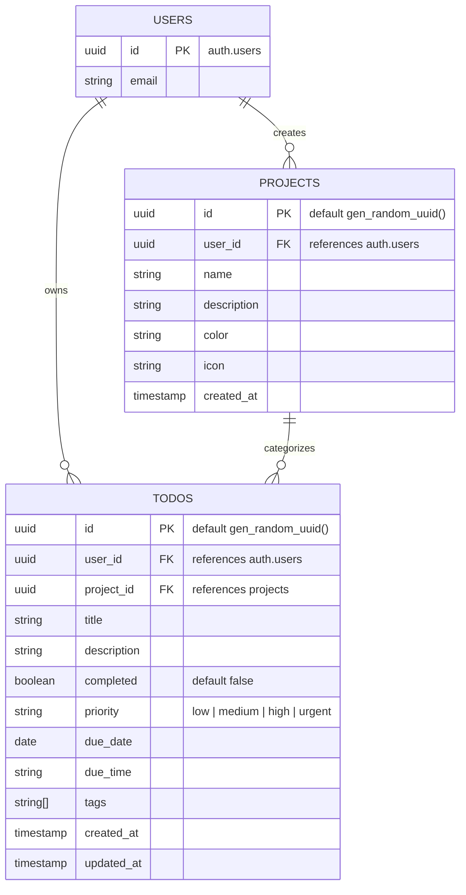

<div align="center">

  # ✦ Ticksy

  ### Organize chaos. Build momentum. Ticksy your wins.

  A production-grade, minimalist task management and deep-focus studio inspired by Notion & Linear.  
  Engineered with **React 19**, **Vite**, **Supabase** (Auth & PostgreSQL with Row-Level Security), and optimized for **Vercel**.

  <br />

  [](https://react.dev/)
  [](https://vitejs.dev/)
  [](https://supabase.com/)
  [](https://www.postgresql.org/)
  [](https://vercel.com/)
  [](https://opensource.org/licenses/MIT)

  <br />

  [Explore Features](#-key-features) • [Tech Stack](#-tech-stack) • [Database Architecture](#-database-schema--security) • [Quick Start](#-getting-started-locally) • [Deployment](#-deployment-to-vercel)

</div>

---

## 📖 Overview

Modern productivity tools have become bloated with complex sprint boards, mandatory metadata fields, and endless notification noise. 

**Ticksy** was built from first principles:
- **Instant Speed**: Zero loading spinners, instant optimistic UI updates, and sub-second local/cloud caching.
- **Notion-Inspired Aesthetic**: High-contrast, elegant typography, curated monochrome light mode (default), and glassmorphic dark mode.
- **True Data Sovereignty**: Powered by Supabase PostgreSQL with strict **Row-Level Security (RLS)** policies. Your tasks and project workspaces belong 100% to you.
- **Frictionless Velocity**: Capture tasks in seconds, organize them into time-boxed agendas, and experience genuine visual satisfaction with celebration confetti and streak tracking.

---

## ✨ Key Features

### 1. 🔐 Supabase Cloud Authentication & Privacy
- **Email & Password Authentication**: Secure sign-up and sign-in powered by Supabase Auth JWTs.
- **Instant Guest Explorer**: Try the full product with sample workflows immediately without needing to configure backend keys upfront.
- **Row-Level Security (RLS)**: Enforced directly at the PostgreSQL layer. Users can only read, insert, update, and delete their own data.
- **Zero-State New Accounts**: Fresh sign-ups start cleanly at **0 tasks and 0 projects**—no unwanted dummy data.

### 2. 📝 Task Management & Instant Capture
- **Expanded Task Attributes**: Title, rich description, priority tiers, scheduled due dates, time markers, project associations, and tag arrays.
- **Priority Matrix**: Color-coded badges for `Urgent`, `High`, `Medium`, and `Low`.
- **Inline Editing & Instant Toggle**: Mark tasks complete with optimistic updates and physics-based celebration confetti.
- **Delete with Instant Undo Toast**: Floating dismissible toast allows recovering accidentally deleted tasks in 1 click (no annoying browser confirm popups).

### 3. 📅 Interactive Calendar Engine & Schedule Timeline
- **Full Month Calendar Grid**: View monthly density with dot badges indicating scheduled tasks.
- **Date-Click Filtering**: Click any calendar date to instantly reveal that day’s scheduled agenda.
- **Smart Timeline**: Automatically groups tasks into `Overdue`, `Today`, `Tomorrow`, `Later This Week`, and `Backlog`.

### 4. 📁 Compartmentalized Project Workspaces
- **Project Workspaces**: Group tasks into dedicated workstreams (e.g. *Product Roadmap*, *Design Tokens*, *Deep Work*).
- **Workspace Analytics**: Real-time progress bars, completion percentages, and task counters per workspace.
- **Custom Project Palette**: Assign custom colors and icons to differentiate work contexts.

### 5. 🎨 Design System & Dual Theme
- **Default Light Mode**: Crisp white canvas, deep obsidian accents (`#18181b`), subtle borders, and zero neon/garish gradients.
- **Sleek Dark Mode**: Deep space indigo palette with glassmorphic cards and soft glowing borders.
- **Live Theme Toggle**: Instant, smooth transition between Light and Dark modes with persistent user preference.
- **Animated Left Sidebar**: Modern sidebar navigation with hover micro-animations and quick task trigger.
- **Motivational Quote Showcase**: 5-second automatic quote ticker with countdown progress bar, category chips, navigation dots, and smart pause-on-hover.

---

## 🛠️ Tech Stack

| Layer | Technology | Description |
| :--- | :--- | :--- |
| **Frontend Framework** | [React 19](https://react.dev/) | Modern component architecture, hooks, and clean state flows |
| **Build Tool & Bundler** | [Vite 8](https://vitejs.dev/) | Sub-second HMR and production bundle optimization |
| **Styling & Design System** | Vanilla CSS3 Tokens | Notion/Linear-inspired tokens, glassmorphism, responsive grid |
| **Icons** | [Lucide React](https://lucide.dev/) | Clean, consistent, and lightweight feather-style iconography |
| **Animations & Confetti** | [Canvas-Confetti](https://www.npmjs.com/package/canvas-confetti) | Physics-based micro-interactions upon task completion |
| **Backend as a Service** | [Supabase](https://supabase.com/) | Cloud Auth, PostgreSQL database, real-time client |
| **Database Security** | PostgreSQL RLS | Row-Level Security policies enforcing strict per-user isolation |
| **Deployment Platform** | [Vercel](https://vercel.com/) | Edge-ready serverless hosting with automated preview builds |

---

## 🗄️ Database Schema & Security

The database schema is defined in [`supabase_schema.sql`](./supabase_schema.sql) and runs on Supabase PostgreSQL with **Row Level Security (RLS)** enabled on all tables:



### Row Level Security (RLS) Policies
Each table implements 4 strict policies:
- `SELECT`: Only rows where `auth.uid() = user_id` are returned.
- `INSERT`: Enforces that `user_id` matches the authenticated user (`with check (auth.uid() = user_id)`).
- `UPDATE`: Only records owned by `auth.uid() = user_id` can be modified.
- `DELETE`: Only records owned by `auth.uid() = user_id` can be deleted.

---

## 🏗️ Project Architecture

```text
d:/PROJECTS/TODO_APP/
├── .env.example                # Template for Supabase URL & Key
├── .gitignore                  # Excludes node_modules, dist, and .env files
├── index.html                  # HTML entry point with modern typography
├── package.json                # Project dependencies and npm scripts
├── supabase_schema.sql         # Production-grade PostgreSQL schema with RLS & indexes
├── vercel.json                 # Single-Page Application (SPA) routing rewrites
├── vite.config.js              # Vite configuration with React plugin
│
└── src/
    ├── main.jsx                # Application root mounting React
    ├── App.jsx                 # Master coordinator (Routing, Auth, Views, Modals)
    ├── App.css                 # Clean application styling overrides
    │
    ├── components/
    │   ├── common/
    │   │   ├── TicksyLogo.jsx      # Geometric brand logo with tick integration
    │   │   └── DeleteToast.jsx     # Floating toast with instant 1-click Undo action
    │   │
    │   ├── dashboard/
    │   │   ├── DashboardView.jsx   # Master workspace coordinator with responsive tabs
    │   │   ├── TodoForm.jsx        # Expandable task creation form with auto-focus
    │   │   ├── TodoList.jsx        # Filterable, sortable list with clean empty state
    │   │   ├── TodoCard.jsx        # Task card with confetti, inline edit, & delete
    │   │   ├── CalendarView.jsx    # Interactive monthly grid & date-specific agenda
    │   │   ├── ScheduleView.jsx    # Chronological grouping (Overdue, Today, Later)
    │   │   ├── ProjectsView.jsx    # Workspace manager with color badges & metrics
    │   │   └── StatsOverview.jsx   # High-level productivity metrics cards
    │   │
    │   ├── landing/
    │   │   ├── HeroSection.jsx     # Expanded headline, quote ticker, & live preview
    │   │   ├── BenefitsSection.jsx # Deep work, sync speed, & timeline feature cards
    │   │   └── AboutSection.jsx    # Editorial layout with philosophy & core pillars
    │   │
    │   ├── layout/
    │   │   ├── Navbar.jsx          # Public/private nav, theme switch, & auth controls
    │   │   ├── Sidebar.jsx         # Left workspace navigation with hover popup animations
    │   │   └── Footer.jsx          # Notion-style footer with Marshall McLuhan quote
    │   │
    │   └── modals/
    │       ├── AuthModal.jsx       # Supabase Sign In / Sign Up modal
    │       ├── AboutModal.jsx      # Quick company & philosophy dialog
    │       ├── ContactModal.jsx    # Feedback & support dialog with validation
    │       └── SupabaseConfigModal.jsx # Runtime backend configuration modal
    │
    ├── constants/
    │   └── mockData.js         # Curated quotes, priority tokens, & sample data
    │
    ├── context/
    │   ├── AuthContext.jsx     # Supabase auth session provider & guest state
    │   ├── TodoContext.jsx     # Real-time task/project state synced with Supabase
    │   └── ThemeContext.jsx    # Light/Dark mode provider with local persistence
    │
    ├── lib/
    │   └── supabase.js         # Supabase client instantiation & fallback handling
    │
    └── styles/
        └── index.css           # Design tokens, typography, glassmorphism, & animations
```

---

## 🚀 Getting Started Locally

### Prerequisites
- [Node.js](https://nodejs.org/) (version 18.0 or higher)
- [npm](https://www.npmjs.com/) (or yarn / pnpm)
- A free [Supabase](https://supabase.com/) account

### 1. Clone the Repository
```bash
git clone https://github.com/YOUR_USERNAME/ticksy.git
cd ticksy
```

### 2. Install Dependencies
```bash
npm install
```

### 3. Configure Supabase Environment Variables
Create a `.env` file in the root directory:
```bash
cp .env.example .env
```

Open `.env` and fill in your Supabase credentials:
```env
VITE_SUPABASE_URL=https://your-project-id.supabase.co
VITE_SUPABASE_ANON_KEY=your_supabase_anon_key_here
```

> [!NOTE]
> *(If you run without `.env`, Ticksy gracefully defaults to Guest Explorer mode using local storage).*

### 4. Initialize Database Schema
1. Open your [Supabase Dashboard](https://supabase.com/dashboard).
2. Navigate to **SQL Editor** &rarr; **New Query**.
3. Copy the contents of [`supabase_schema.sql`](./supabase_schema.sql) and paste them into the editor.
4. Click **Run**.
5. *(Recommended)* Under **Authentication** &rarr; **Providers** &rarr; **Email**, toggle **OFF** *"Confirm email"* for instant sign-ups.

### 5. Start the Development Server
```bash
npm run dev
```

Visit **`http://localhost:5173`** in your browser.

---

## ☁️ Deployment to Vercel

Ticksy is pre-configured with [`vercel.json`](./vercel.json) rewrite rules for Single Page Application (SPA) routing.

### Option A: Via Vercel Web Dashboard (Recommended)
1. Push your repository to GitHub:
   ```bash
   git add .
   git commit -m "feat: complete Ticksy production build"
   git push origin main
   ```
2. Go to [Vercel Dashboard](https://vercel.com/new) and click **Import Project**.
3. Select your `ticksy` repository.
4. Under **Environment Variables**, add:
   - `VITE_SUPABASE_URL`: `https://your-project-id.supabase.co`
   - `VITE_SUPABASE_ANON_KEY`: `your_supabase_anon_key_here`
5. Click **Deploy**. Your app will be live globally in under 60 seconds!

### Option B: Via Vercel CLI
```bash
npm i -g vercel
vercel
```

---

## 🔒 Security Best Practices

- **Row-Level Security (RLS)**: Active on both `todos` and `projects` tables. No user can read or modify another user's records under any circumstance.
- **Git Protection**: `.env`, `.env.*`, and `.env.example` are ignored in [`.gitignore`](./.gitignore) to prevent credentials from ever leaking to public version control.
- **Input Sanitization**: All task titles, descriptions, and tag inputs are sanitized and trimmed before state mutation and database insertion.

---

## 📄 License

Distributed under the **MIT License**. See [`LICENSE`](./LICENSE) for more information.

---

<div align="center">
  <sub>Built with clean code, minimalist design, and deep focus for creators worldwide.</sub>
  <br />
  <strong>Ticksy Inc. © 2026</strong>
</div>